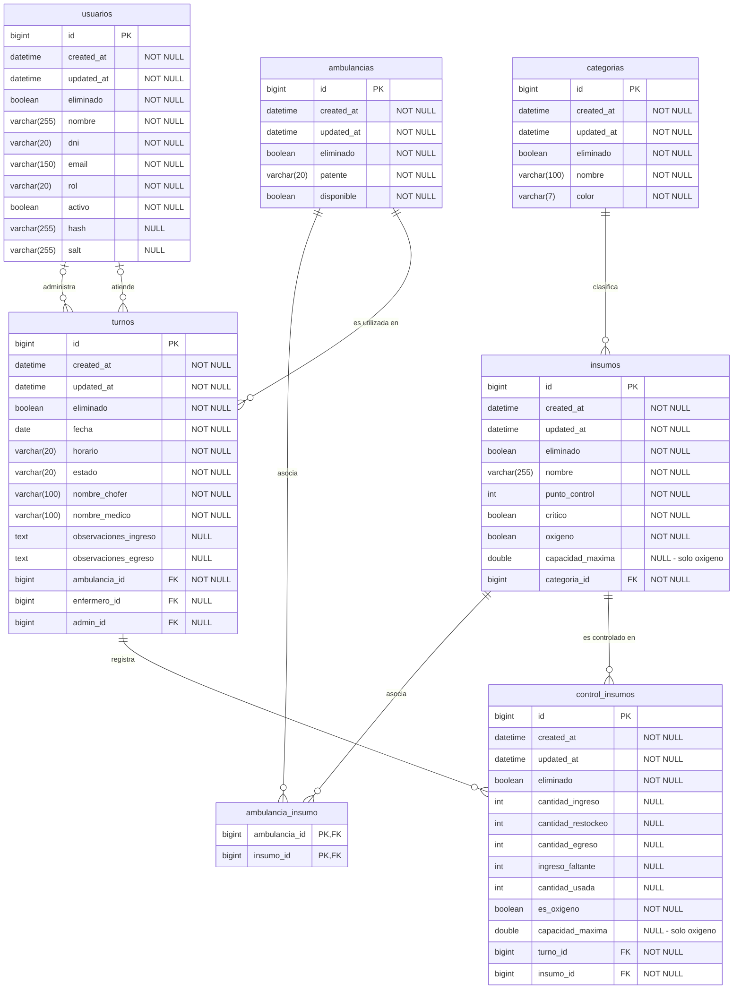

> **Nota sobre la asignación de personal:** los campos `enfermero_id` y `admin_id` admiten valores nulos a nivel de persistencia para permitir el manejo de bajas lógicas sin eliminar físicamente los registros relacionados. La obligatoriedad de asignar el personal correspondiente a cada turno se controla mediante las reglas de negocio implementadas en el backend. Por este motivo, la posibilidad de almacenar `NULL` en estas relaciones no implica que la aplicación permita operar libremente un turno sin el personal requerido.